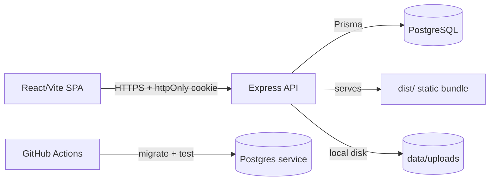

# Sanad Commerce — سند للتجارة

Multi-tenant Arabic e-commerce operating platform. Merchants create a store,
finish a five-step onboarding wizard, manage products/orders/content/growth,
and publish a branded storefront — with Cash-on-Delivery today and honest
integration boundaries for online payments, AI, WhatsApp and carriers.

## Product surface

| Surface | Path | Notes |
|---------|------|-------|
| Marketing site | `/` | Public landing page; signed-in visitors are routed to the dashboard |
| Sign in / register | `/auth/login`, `/auth/register` | Cookie session, show/hide password, inline errors, safe redirect |
| Onboarding | `/onboarding` | Five RTL steps, autosave, real image upload, template + selling setup, publish |
| Dashboard | `/dashboard`, `/dashboard/*` | Dark-first RTL shell, 22 routes in five groups, mobile drawer/bottom nav |
| Storefront | `/store/:subdomain`, `/store/:subdomain/*` | Published stores only; unpublished stores show a branded “قيد التجهيز” page |

The dashboard covers overview, products, categories, orders, customers,
wallet, abandoned carts, upsells, related products, coupons, shipping, pages,
design, blog, affiliates, loyalty, dropshipping, reviews, AI assistant,
reports, settings, audit logs, domains, team and learn.

## Architecture



- **Frontend:** React 19 + Vite + Tailwind 4, Arabic-first RTL shell with a
  lightweight History-API router (no React Router dependency).
- **Backend:** Express 4 + Prisma 7 + PostgreSQL 16 (pg adapter), Argon2id
  passwords, httpOnly SameSite=Lax cookie sessions, Zod strict validation on
  every body/param/query, deny-by-default authorization.
- **Data:** every operational table is store-scoped (`storeId`). Dashboard
  routes resolve the store server-side and require `requireStoreOwnership`;
  client-supplied store IDs are never trusted.

## Tech stack

| Layer | Choice |
|-------|--------|
| Frontend | React 19, Vite 8, Tailwind 4, lucide-react |
| Backend | Express 4, Prisma 7 (@prisma/adapter-pg), PostgreSQL 16 |
| Auth | Argon2id (m=19456, t=2, p=1), opaque HMAC'd session cookies |
| Validation | Zod strict schemas; params, query and JSON bodies |
| Hardening | helmet, strict CORS allowlist, CSRF origin check, rate limits, pino logs |
| Media | Local-disk `MediaAsset` storage with an explicit future S3 boundary |
| Tests | Vitest + supertest against real per-worker Postgres databases |
| Deploy | Multi-stage Dockerfile (non-root, prod deps), docker-compose (db + migrate + app) |

## Local setup

Requirements: Node 24.x, npm 11+, Docker Desktop (for Postgres).

```powershell
npm ci
copy .env.example .env   # then set SESSION_SECRET (32+ chars) and DATABASE_URL
docker compose up -d db
npm run db:migrate       # apply Prisma migrations
npm run db:seed          # optional demo data (DEMO_MODE=true only)
npm run dev              # frontend :3000 + backend :5000 (API first)
```

`npm run dev` starts both processes and waits for the API health check before
starting Vite, so `/api` requests cannot hit a dead proxy target. Use
`npm run dev:web` or `npm run dev:backend` to run one side alone.

Seeded demo login (dev only): `merchant@saraya.sanad.app` + `DEMO_MERCHANT_PASSWORD`.

## Environment variables

| Name | Required | Default | Notes |
|------|----------|---------|-------|
| `PORT` | no | `5000` | API listen port |
| `NODE_ENV` | no | `development` | `development` / `test` / `production` |
| `DATABASE_URL` | **yes** | — | `postgresql://…`; boot fails without it |
| `SESSION_SECRET` | prod: **yes** | insecure dev default | 32+ chars in production; rotation logs everyone out |
| `CORS_ORIGIN` | no | `http://localhost:3000` | comma-separated, no wildcards |
| `TRUST_PROXY` | no | `false` | `true` only behind a trusted proxy |
| `JSON_BODY_LIMIT` | no | `256kb` | max JSON body (media has its own parser/limit) |
| `LOG_LEVEL` | no | `info` | pino level |
| `APP_URL` | no | `http://localhost:3000` | absolute base used in onboarding links/integrations |
| `VITE_API_URL` | no | `""` | build-time API base; empty = same origin |
| `STORAGE_DRIVER` | no | `local` | `local` is implemented; `s3` fails honestly until an adapter is added |
| `STORAGE_DIR` | no | `data/uploads` | local upload directory, served at `/uploads` |
| `MEDIA_MAX_BYTES` | no | `5242880` | per-image upload limit (max 20 MB) |
| `AI_BASE_URL` | no | — | OpenAI-compatible endpoint; assistant stays disabled without it |
| `AI_API_KEY` | no | — | required with `AI_BASE_URL` |
| `AI_MODEL` | no | `gpt-4o-mini` | model sent to the compatible endpoint |
| `PAYMENT_PROVIDER` | no | — | stored provider name; a provider-specific adapter is still required |
| `PAYMENT_SECRET_KEY` | no | — | required with `PAYMENT_PROVIDER` |
| `WHATSAPP_ACCESS_TOKEN` | no | — | Cloud API boundary; `wa.me` links work without it |
| `WHATSAPP_PHONE_ID` | no | — | required with the access token |
| `SHIPPING_PROVIDER` | no | — | manual carriers remain available without it |
| `SHIPPING_API_KEY` | no | — | reserved for a carrier adapter |
| `DEMO_MODE` | no | `false` | `true` enables demo seed/login (dev only) |
| `DEMO_MERCHANT_PASSWORD` | demo | — | required for seed in production (refuses otherwise) |

## Scripts

| Script | Purpose |
|--------|---------|
| `npm run dev` | frontend + backend together (recommended); waits for API health |
| `npm run dev:web` / `dev:backend` | frontend only / backend only |
| `npm run dev:full` | alias for `npm run dev` |
| `npm run build` / `build:server` | frontend bundle / esbuild server bundle |
| `npm start` | run production bundle (`dist-server/server.cjs`, no devDeps) |
| `npm run lint` | `tsc --noEmit` |
| `npm test` | Vitest integration suite (needs Postgres) |
| `npm run db:migrate` / `db:migrate:dev` / `db:seed` / `db:reset` | deploy migrations / dev migrate / demo seed / dev-only reset (refuses production) |

## API reference

Auth uses the httpOnly cookie `sanad_session`. Every store-scoped route
resolves `:subdomain` server-side and returns `403` when it is not the caller's
store. Public routes are explicitly allowlisted and rate-limited.

### Public

| Method | Path | Notes |
|--------|------|-------|
| GET | `/api/health` | liveness + DB check (`503` when down) |
| POST | `/api/auth/register` | creates merchant + store atomically; rate-limited |
| POST | `/api/auth/login` | rotates session; rate-limited |
| GET | `/api/stores/:sub` | public storefront summary (no phone/plan) |
| GET | `/api/storefront/:sub` | branding, categories, featured products, pages, shipping zones, publish gate |
| GET | `/api/storefront/:sub/products` | active catalog with search/category/price/sort/pagination |
| GET | `/api/storefront/:sub/products/:slug` | product detail, variants, approved reviews, related products |
| GET | `/api/storefront/:sub/categories` | active categories with product counts |
| GET | `/api/storefront/:sub/pages/:slug` | published CMS page |
| GET | `/api/storefront/:sub/blog` and `/blog/:slug` | published/scheduled posts |
| GET / POST | `/api/storefront/:sub/reviews[/:productId]` | approved reviews; submissions start `pending` |
| POST | `/api/storefront/:sub/coupon` | validates a coupon against server-side rules |
| POST | `/api/storefront/:sub/shipping-quote` | zone/rate/free-threshold/COD quote |
| POST | `/api/storefront/:sub/cart` | snapshots an abandoned cart from real catalog lines |
| GET | `/api/storefront/:sub/orders/:orderNumber?phone=` | phone-scoped order tracking |
| POST | `/api/stores/:sub/checkout` | public COD checkout; totals/stock/coupons computed server-side |
| POST | `/api/leads` | attributed to the store when logged in; payload capped |

### Authenticated merchant

| Area | Paths |
|------|-------|
| Session | `GET /api/auth/me`, `POST /api/auth/logout`, `POST /api/auth/password` |
| Account | `GET/PATCH /api/account/store`, `GET /api/stores`, `GET /api/leads` |
| Onboarding | `GET/PATCH /api/onboarding`, `POST /api/onboarding/complete` |
| Catalog | `/api/stores/:sub/products`, `/categories`, `/reviews` |
| Sales | `/api/stores/:sub/orders`, `/orders/:id/status`, `/orders/:id/payment-status`, `/orders/:id/timeline`, `/orders/:id/notes`, `/orders/:id/refunds`, `/orders/export`, `/orders/bulk-status`, `/abandoned-carts` |
| Customers | `/api/stores/:sub/customers`, `/customers/:id`, `/customers/:id/addresses`, `/customers/export` |
| Money | `/api/stores/:sub/wallet`, `/wallet/deposits` |
| Growth | `/api/stores/:sub/coupons`, `/shipping-zones`, `/upsells`, `/related-products`, `/affiliates`, `/loyalty`, `/loyalty/rules`, `/loyalty/adjust` |
| Content | `/api/stores/:sub/pages`, `/blog`, `/design` |
| Dropshipping | `/api/stores/:sub/dropshipping`, `/suppliers`, `/dropship-products` |
| Assistant | `GET/POST /api/stores/:sub/assistant`, `/assistant/generate` |
| Reports | `GET /api/stores/:sub/reports` |
| Settings | `GET/PATCH /api/stores/:sub/settings`, `/notification-preferences`, `/audit-logs`, `/domains`, `/team` |
| Media | `POST/GET /api/media` (base64 image upload, local disk) |

Order statuses: `pending`, `needs_confirmation`, `confirmed`, `preparing`,
`ready_to_ship`, `shipped`, `out_for_delivery`, `delivered`, `cancelled`,
`returned`. Payment statuses are separate: `unpaid`, `paid`,
`partially_refunded`, `refunded`, `failed`. Invalid transitions return
`409 INVALID_TRANSITION`.

## Security notes

- Deny by default; ownership is derived from the session, never from client input.
- Passwords: Argon2id; legacy scrypt hashes verify once and upgrade on login.
- Sessions: 256-bit tokens, HMAC-`SESSION_SECRET` hashes in DB, 7-day expiry,
  rotation on login, logout invalidates server-side.
- CSRF: SameSite=Lax cookies + Origin/Referer allowlist check on mutations.
- Brute force: 30 req/15 min on login/register; 60 on public writes.
- All request bodies/params/queries are strict Zod schemas; unknown fields are rejected.
- Public catalog responses whitelist shopper-safe fields (no `costPrice`, barcode or internal status).
- Checkout validates SKUs/variants, prices, stock, coupons and shipping inside a
  database transaction; duplicate lines are merged so stock cannot be split to oversell.
- Orders keep status and payment status independent.
- No secrets in the client bundle; passwords/tokens are never stored in localStorage.

## Tests

```powershell
npm test
# Test Files  15 passed (15)
# Tests       50 passed (50)
```

Coverage includes auth/session hardening, the authorization matrix, tenant
isolation for the old and new dashboard endpoints, product CRUD, order
transitions and numbering, wallet/summary currency behavior, checkout pricing
and race conditions, storefront publishing gates, catalog/variants/reviews,
coupons/shipping/COD checkout, phone-scoped order lookup and cross-store
isolation.

## Integrations (honest boundaries)

- **Online payments:** no provider-specific adapter is installed. COD works;
  online checkout returns `ONLINE_PAYMENT_DISABLED` or
  `PAYMENT_PROVIDER_NOT_CONFIGURED` instead of faking a charge.
- **AI assistant:** works only when `AI_BASE_URL` + `AI_API_KEY` point to a
  real OpenAI-compatible endpoint; otherwise it returns `AI_NOT_CONFIGURED`.
- **WhatsApp:** real `wa.me` links work now. Cloud API credentials are stored
  but automatic sending still requires an approved template.
- **Shipping:** zones, rates, COD fees and free-shipping thresholds are real;
  carrier/tracking integration is manual.
- **Media:** local disk works. `STORAGE_DRIVER=s3` fails honestly until an S3
  adapter is implemented.

## Deployment

See [docs/HANDOVER.md](docs/HANDOVER.md) and
[docs/SAAS_PLATFORM_REPORT.md](docs/SAAS_PLATFORM_REPORT.md). Short version:

```powershell
docker compose up --build   # db + migrate + app (set SESSION_SECRET first)
```

## Known limitations

- Online payment adapter, S3 adapter and carrier auto-send are not implemented.
- WhatsApp Cloud API auto-send needs an approved template; links are manual.
- One store per merchant account (schema supports more; API/UI assume one).
- No email verification, password reset, 2FA, or subscription billing flows.
- Rate limits are per-instance memory (use Redis for horizontal scaling).
- `docker compose up` end-to-end is documented but was not re-verified in this
  environment; the production bundle itself is built and tested with plain Node.
