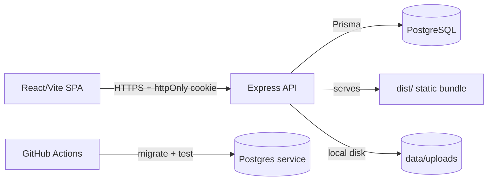

# Sanad Commerce — سند للتجارة

Multi-tenant Arabic e-commerce operating platform. Merchants create a store,
finish a five-step onboarding wizard, manage products/orders/content/growth,
and publish a branded storefront — with Cash-on-Delivery today and honest
integration boundaries for online payments, AI, WhatsApp and carriers.

## Product surface

| Surface | Path | Notes |
|---------|------|-------|
| Marketing site | `/` | Public landing page; signed-in visitors are routed to the dashboard |
| Sign in / register | `/auth/login`, `/auth/register` | Cookie session, show/hide password, inline errors, safe redirect |
| Team sign in / invite | `/team/login`, `/team/invite/:token` | Invited members sign in to the owner's store with a scoped team role |
| Platform admin | `/admin` | Separate `PlatformAdmin` identity, its own cookie + MFA, permission-scoped back-office |
| Onboarding | `/onboarding` | Five RTL steps, autosave, real image upload, template + selling setup, publish |
| Dashboard | `/dashboard`, `/dashboard/*` | Dark-first RTL shell, 22 routes in five groups; incomplete features are gated with a visible reason |
| Storefront | `/store/:subdomain`, custom domains | Published stores only; unpublished stores show a branded “قيد التجهيز” page |

The dashboard covers overview, products, categories, orders, customers,
abandoned carts, related products, coupons, shipping, pages, design, blog,
affiliates, reviews, AI assistant, reports, settings, audit logs, domains,
team, wallet and the quick guide. Wallet deposits are real pending requests that
change the balance only after a finance admin approves them. Upsells, loyalty
and dropshipping remain in the codebase but are gated and hidden from navigation
until their approval and settlement workflows ship.

## Architecture



- **Frontend:** React 19 + Vite + Tailwind 4, Arabic-first RTL shell with a
  lightweight History-API router (no React Router dependency).
- **Backend:** Express 4 + Prisma 7 + PostgreSQL 16 (pg adapter), Argon2id
  passwords, httpOnly SameSite=Lax cookie sessions, Zod strict validation on
  every body/param/query, deny-by-default authorization.
- **Data:** every operational table is store-scoped (`storeId`). Dashboard
  routes resolve the store server-side and require `requireStoreOwnership`;
  client-supplied store IDs are never trusted.

## Tech stack

| Layer | Choice |
|-------|--------|
| Frontend | React 19, Vite 8, Tailwind 4, lucide-react |
| Backend | Express 4, Prisma 7 (@prisma/adapter-pg), PostgreSQL 16 |
| Auth | Argon2id (m=19456, t=2, p=1), opaque HMAC'd session cookies, separate platform-admin cookie, TOTP 2FA |
| Validation | Zod strict schemas; params, query and JSON bodies |
| Hardening | helmet, strict CORS/CSRF, PostgreSQL-shared rate limits, validated media, 2FA, PII masking, pino logs |
| Media | Local-disk `MediaAsset` storage with an explicit future S3 boundary |
| Tests | Vitest + supertest against real per-worker Postgres databases |
| Deploy | Multi-stage Dockerfile (non-root, prod deps), docker-compose (db + migrate + app) |

## Local setup

Requirements: Node 24.x, npm 11+, Docker Desktop (for Postgres).

```powershell
npm ci
copy .env.example .env   # then set SESSION_SECRET (32+ chars) and DATABASE_URL
docker compose up -d db
npm run db:migrate       # apply Prisma migrations
npm run db:seed          # optional demo data (DEMO_MODE=true only)
npm run dev              # frontend :3000 + backend :5000 (API first)
```

`npm run dev` starts both processes and waits for the API health check before
starting Vite, so `/api` requests cannot hit a dead proxy target. Use
`npm run dev:web` or `npm run dev:backend` to run one side alone.

Seeded demo login (dev only): `merchant@saraya.sanad.app` + `DEMO_MERCHANT_PASSWORD`.

## Environment variables

| Name | Required | Default | Notes |
|------|----------|---------|-------|
| `PORT` | no | `5000` | API listen port |
| `NODE_ENV` | no | `development` | `development` / `test` / `production` |
| `DATABASE_URL` | **yes** | — | `postgresql://…`; boot fails without it |
| `SESSION_SECRET` | prod: **yes** | insecure dev default | 32+ chars in production; rotation logs everyone out |
| `ADMIN_BOOTSTRAP_EMAIL` / `ADMIN_BOOTSTRAP_PASSWORD` | pair | — | creates the first `super_admin` at boot; 12+ char password; idempotent, never resets an existing admin |
| `ADMIN_BOOTSTRAP_NAME` | no | `Platform Admin` | display name for the bootstrapped first admin |
| `CORS_ORIGIN` | no | `http://localhost:3000` | comma-separated, no wildcards |
| `TRUST_PROXY` | no | `false` | `false`, a trusted hop count (`1`), or proxy IP/CIDR list; `true` is rejected |
| `JSON_BODY_LIMIT` | no | `256kb` | max JSON body (media has its own parser/limit) |
| `LOG_LEVEL` | no | `info` | pino level; PII/secrets are redacted |
| `APP_URL` | no | `http://localhost:3000` | absolute base used in verification/reset/tracking links |
| `VITE_API_URL` | no | `""` | build-time API base; empty = same origin |
| `STORAGE_DRIVER` | no | `local` | only `local` is implemented; `s3` fails at startup until an adapter is added |
| `STORAGE_DIR` | no | `data/uploads` | local upload directory, served at `/uploads` with inert-content headers |
| `MEDIA_MAX_BYTES` | no | `5242880` | per-image upload limit (max 20 MB) |
| `MEDIA_MAX_DIMENSION` | no | `6000` | max width/height after decoding |
| `SMTP_URL` / `EMAIL_FROM` | pair | — | enable verification/reset delivery; production refuses `REQUIRE_EMAIL_VERIFICATION=true` without them |
| `REQUIRE_EMAIL_VERIFICATION` | no | `false` | blocks login until the address is verified |
| `EMAIL_VERIFICATION_TTL_MINUTES` | no | `1440` | single-use verification link lifetime |
| `PASSWORD_RESET_TTL_MINUTES` | no | `60` | single-use reset link lifetime |
| `TRACKING_SECRET` | no | derived | 32+ chars in production when set; signs order-tracking links |
| `TOTP_ENCRYPTION_KEY` | no | derived | 32+ chars in production when set; encrypts 2FA secrets at rest |
| `TRACKING_TOKEN_TTL_DAYS` | no | `30` | signed tracking-link lifetime |
| `CART_RETENTION_DAYS` | no | `30` | abandoned-cart sweep cutoff |
| `AUDIT_RETENTION_DAYS` | no | `365` | audit-log sweep cutoff |
| `EXPORT_MAX_ROWS` | no | `50000` | CSV export cap; larger exports return `413 EXPORT_TOO_LARGE` |
| `AI_BASE_URL` | no | — | OpenAI-compatible endpoint; assistant stays disabled without it |
| `AI_API_KEY` | no | — | required with `AI_BASE_URL` |
| `AI_MODEL` | no | `gpt-4o-mini` | model sent to the compatible endpoint |
| `PAYMENT_PROVIDER` | no | — | stored provider name; a provider-specific adapter is still required |
| `PAYMENT_SECRET_KEY` | no | — | required with `PAYMENT_PROVIDER` |
| `WHATSAPP_ACCESS_TOKEN` | no | — | Cloud API boundary; `wa.me` links work without it |
| `WHATSAPP_PHONE_ID` | no | — | required with the access token |
| `SHIPPING_PROVIDER` | no | — | manual carriers remain available without it |
| `SHIPPING_API_KEY` | no | — | reserved for a carrier adapter |
| `DEMO_MODE` | no | `false` | `true` enables demo seed/login (dev only) |
| `DEMO_MERCHANT_PASSWORD` | demo | — | required for seed in production (refuses otherwise) |

## Scripts

| Script | Purpose |
|--------|---------|
| `npm run dev` | frontend + backend together (recommended); waits for API health |
| `npm run dev:web` / `dev:backend` | frontend only / backend only |
| `npm run dev:full` | alias for `npm run dev` |
| `npm run build` / `build:server` | frontend bundle / esbuild server bundle |
| `npm start` | run production bundle (`dist-server/server.cjs`, no devDeps) |
| `npm run lint` | `tsc --noEmit` |
| `npm test` | Vitest integration suite (needs Postgres) |
| `npm run db:migrate` / `db:migrate:dev` / `db:seed` / `db:reset` | deploy migrations / dev migrate / demo seed / dev-only reset (refuses production) |

## API reference

Merchant-owner and invited team sessions use the httpOnly cookie
`sanad_session`; platform administrators use a separate `sanad_admin_session`
cookie and a separate `AdminSession` table. Every store-scoped route resolves
`:subdomain` server-side, enforces the owner's store or the team member's
permission, and returns `403` when it is not allowed. Public routes are
explicitly allowlisted and rate-limited.

### Public

| Method | Path | Notes |
|--------|------|-------|
| GET | `/api/health` | liveness + DB check (`503` when down) |
| POST | `/api/auth/register` | creates merchant + store atomically; issues a verification link; rate-limited |
| POST | `/api/auth/login` | password + optional TOTP/recovery code; rotates session; rate-limited |
| POST | `/api/auth/verify-email` | consumes a single-use verification token |
| POST | `/api/auth/verify-email/resend` | public, email-based resend with anti-enumeration response |
| POST | `/api/auth/forgot-password` | public, always responds identically; rate-limited |
| POST | `/api/auth/reset-password` | single-use token; revokes every existing session |
| GET | `/api/stores/:sub` | public storefront summary (no phone/plan) |
| GET | `/api/storefront/:sub` | branding, categories, featured products, pages, shipping zones, publish gate |
| GET | `/api/storefront/:sub/products` | active catalog with search/category/price/sort/pagination |
| GET | `/api/storefront/:sub/products/:slug` | product detail, variants, approved reviews, related products |
| GET | `/api/storefront/:sub/categories` | active categories with product counts |
| GET | `/api/storefront/:sub/pages/:slug` | published CMS page |
| GET | `/api/storefront/:sub/blog` and `/blog/:slug` | published/scheduled posts |
| GET / POST | `/api/storefront/:sub/reviews[/:productId]` | approved reviews; submissions start `pending` |
| POST | `/api/storefront/:sub/coupon` | validates a coupon against server-side rules |
| POST | `/api/storefront/:sub/shipping-quote` | zone/rate/free-threshold/COD quote |
| POST | `/api/storefront/:sub/cart` | snapshots a cart from real catalog lines; rejects anonymous empty carts |
| GET | `/api/storefront/:sub/orders/:orderNumber?token=…` | signed tracking token (preferred) or `phone=` fallback; PII masked |
| POST | `/api/stores/:sub/checkout` | public COD checkout; totals/stock/coupons computed server-side |
| POST | `/api/leads` | attributed to the store when logged in; payload capped |

### Authenticated merchant

| Area | Paths |
|------|-------|
| Session | `GET /api/auth/me`, `POST /api/auth/logout`, `POST /api/auth/password`, `POST /api/auth/sessions/revoke-others` |
| Two-factor | `POST /api/auth/2fa/setup`, `/2fa/enable`, `/2fa/disable` (TOTP + one-time recovery codes) |
| Account | `GET/PATCH /api/account/store`, `GET /api/stores`, `GET /api/leads` |
| Onboarding | `GET/PATCH /api/onboarding`, `POST /api/onboarding/complete` |
| Catalog | `/api/stores/:sub/products`, `/categories`, `/reviews` |
| Sales | `/api/stores/:sub/orders`, `/orders/:id/status`, `/orders/:id/payment-status`, `/orders/:id/timeline`, `/orders/:id/notes`, `/orders/:id/refunds`, `/orders/export`, `/orders/bulk-status`, `/abandoned-carts` |
| Customers | `/api/stores/:sub/customers`, `/customers/:id`, `/customers/:id/addresses`, `/customers/export` |
| Money | `/api/stores/:sub/wallet`, `/wallet/deposits` |
| Growth | `/api/stores/:sub/coupons`, `/shipping-zones`, `/upsells`, `/related-products`, `/affiliates`, `/loyalty`, `/loyalty/rules`, `/loyalty/adjust` |
| Content | `/api/stores/:sub/pages`, `/blog`, `/design` |
| Dropshipping | `/api/stores/:sub/dropshipping`, `/suppliers`, `/dropship-products` |
| Assistant | `GET/POST /api/stores/:sub/assistant`, `/assistant/generate` |
| Reports | `GET /api/stores/:sub/reports` |
| Settings | `GET/PATCH /api/stores/:sub/settings`, `/notification-preferences`, `/audit-logs`, `/domains` (+ one-time challenge rotation), `/team`, `/publishing` |
| Media | `POST/GET /api/media` (base64 image upload, local disk) |

### Team member

| Area | Paths |
|------|-------|
| Invitation | `GET /api/team/invitations/:token`, `POST /api/team/invitations/accept` (single-use token, password setup) |
| Session | `POST /api/team/login`, `GET /api/team/me`, `POST /api/team/logout` (same `sanad_session` cookie, bound to `teamMemberId`) |
| Store | The same store routes as the owner, filtered by `admin` / `manager` / `staff` / `viewer` permissions; sensitive reads (`team`, `domains`, `wallet`, `audit-logs`) require their named permission |

### Platform administrator

| Area | Paths |
|------|-------|
| Auth | `POST /api/admin/auth/login`, `/logout`, `GET /api/admin/auth/me`, `/2fa/setup`, `/2fa/enable`, `/2fa/disable`, `/password`, `/sessions/revoke-others` |
| Back-office | `GET /api/admin/overview`, `/stores`, `/merchants`, `/subscription-payments`, `/wallet/transactions`, `/support-tickets`, `/reports`, `/domains`, `/audit`, `/feature-flags`, `/admins`, `/leads` |
| Writes | Store approval/suspension/settings, domain/TLS review, subscription and wallet approvals, support replies, feature flags, administrator management — each requires a named admin permission and is audited |

Order statuses: `pending`, `needs_confirmation`, `confirmed`, `preparing`,
`ready_to_ship`, `shipped`, `out_for_delivery`, `delivered`, `cancelled`,
`returned`. Payment statuses are separate: `unpaid`, `paid`,
`partially_refunded`, `refunded`, `failed`. Invalid transitions return
`409 INVALID_TRANSITION`.

## Security notes

- Deny by default; ownership is derived from the session, never from client input.
- Passwords: Argon2id; legacy scrypt hashes verify once and upgrade on login.
- Sessions: 256-bit tokens, HMAC-`SESSION_SECRET` hashes in DB, 7-day expiry,
  rotation on login, logout invalidates server-side. Password change keeps the
  current session and revokes the rest; reset revokes all sessions. Platform
  admins use a separate 8-hour cookie/table and MFA state; merchant/team cookies
  can never authenticate `/api/admin`.
- Team RBAC: owner sessions always have full access; team roles are `admin`,
  `manager`, `staff`, `viewer`, and the API derives the required permission from
  the method/path. Role changes and suspensions apply on the next request.
- Custom domains: only the raw `Host` header is trusted (`X-Forwarded-Host` is
  ignored), the domain must be verified and its store published, and unknown
  hosts receive a 404 instead of the platform SPA.
- Email verification and password reset: random 256-bit tokens, only an HMAC is
  stored, links are single-use and expire. `REQUIRE_EMAIL_VERIFICATION` blocks
  login until the address is confirmed.
- 2FA: RFC 6238 TOTP with AES-256-GCM encrypted secrets; recovery codes are
  HMAC hashes and are consumed exactly once (transaction-scoped lock).
- CSRF: SameSite=Lax cookies + Origin/Referer allowlist on mutations; production
  rejects mutations that carry no source header.
- Brute force: distributed fixed-window limits in PostgreSQL (`rate_limit_buckets`)
  are shared by every replica: auth/email, public writes, tracking, carts,
  exports and media each have dedicated budgets.
- `TRUST_PROXY=true` is rejected; use an explicit hop count or proxy IP/CIDR list
  so `X-Forwarded-For` cannot spoof rate-limit identities.
- Uploads: SVG/HTML are rejected; JPEG/PNG/WebP/GIF are magic-byte checked,
  decoded/re-encoded to strip metadata and polyglot payloads, dimension/frame
  capped, and served with `nosniff`, sandbox CSP and CORP/COEP headers.
- All request bodies/params/queries are strict Zod schemas; unknown fields are rejected.
- Public catalog responses whitelist shopper-safe fields (no `costPrice`, barcode or internal status).
- Checkout validates SKUs/variants, prices, stock, coupons and shipping inside a
  database transaction; duplicate lines are merged so stock cannot be split to oversell.
- Order tracking prefers an HMAC-signed, expiring token bound to one store/order;
  phone fallback is rate-limited and both return masked phone only (no order id,
  address or email).
- Exports are role-gated (owner, team `admin`/`manager`), audited,
  rate-limited, `no-store`, streamed, row-capped, and CSV formula-injection safe.
- Domain verification tokens are disclosed once at creation/rotation; list,
  settings and verify responses never echo tokens or raw DNS records.
- Carts require an item or contact signal, are rate-limited, and are swept by the
  retention job along with audit logs, expired sessions/tokens and rate buckets.
- Logs redact cookies/authorization, passwords, tokens and mask customer
  phone/email values; order status and payment status remain independent.
- No secrets in the client bundle; passwords/tokens are never stored in localStorage.

## Tests

```powershell
npm test
# Test Files  19 passed (19)
# Tests       100 passed (100)
```

Coverage includes auth/session hardening, the authorization matrix, tenant
isolation for the old and new dashboard endpoints, product CRUD, order
transitions and numbering, wallet/summary currency behavior, checkout pricing
and race conditions, storefront publishing gates, catalog/variants/reviews,
coupons/shipping/COD checkout, phone/token-scoped order lookup and cross-store
isolation, plus the Phase 2 security matrix: SVG/polyglot/media re-encoding,
CSRF/proxy rules, atomic distributed limits, TOTP 2FA and recovery codes,
verification/reset single-use tokens, export RBAC/audit/formula safety, domain
token non-disclosure, tracking/cart abuse limits, retention sweeps and log PII
masking.

## Integrations (honest boundaries)

- **Online payments:** no provider-specific adapter is installed. COD works;
  online checkout returns `ONLINE_PAYMENT_DISABLED` or
  `PAYMENT_PROVIDER_NOT_CONFIGURED` instead of faking a charge.
- **AI assistant:** works only when `AI_BASE_URL` + `AI_API_KEY` point to a
  real OpenAI-compatible endpoint; otherwise it returns `AI_NOT_CONFIGURED`.
- **WhatsApp:** real `wa.me` links work now. Cloud API credentials are stored
  but automatic sending still requires an approved template.
- **Shipping:** zones, rates, COD fees and free-shipping thresholds are real;
  carrier/tracking integration is manual.
- **Media:** local disk works. `STORAGE_DRIVER=s3` fails at startup until an S3
  adapter is implemented.

## Deployment

See [docs/HANDOVER.md](docs/HANDOVER.md) and
[docs/SAAS_PLATFORM_REPORT.md](docs/SAAS_PLATFORM_REPORT.md). Short version:

```powershell
docker compose up --build   # db + migrate + app (set SESSION_SECRET first)
```

## Known limitations

- Online payment adapter, S3 adapter and carrier auto-send are not implemented.
- WhatsApp Cloud API auto-send needs an approved template; links are manual.
- One store per merchant account (schema supports more; API/UI assume one).
- Verification/reset emails require `SMTP_URL` + `EMAIL_FROM`; without them the
  API reports email as unconfigured (dev-only debug tokens are returned outside production).
- Subscription billing is manual: owners submit payment details and an admin
  approves them; automatic charging/renewal is not implemented.
- Rate limits are shared through PostgreSQL; no Redis dependency is required.
- `docker compose up` end-to-end is documented but was not re-verified in this
  environment; the production bundle itself is built and tested with plain Node.
