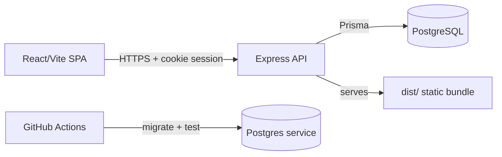

# Sanad Commerce — سند للتجارة

Multi-tenant Arabic e-commerce operating platform: merchants create a store,
manage products/orders/inventory, accept Cash-on-Delivery and cross-border
orders from Egypt to the GCC — with 0% platform commission.

## Architecture



- **Frontend:** React 19 + Vite + Tailwind, bilingual (AR/RTL + EN). In dev it
  proxies `/api` to the backend; in production the backend serves the bundle.
- **Backend:** Express 4 + Prisma 7 + PostgreSQL 16. Cookie sessions
  (httpOnly, SameSite=Lax, Secure in production), Argon2id passwords, zod
  validation on every input, deny-by-default authorization with per-store
  ownership checks.
- **Data:** one database, all tables store-scoped (`storeId`) with cascade
  rules. No tenant can read or write another tenant's records (tested).

## Tech stack

| Layer    | Choice |
|----------|--------|
| Frontend | React 19, Vite 8, Tailwind 4, lucide-react |
| Backend  | Express 4, Prisma 7 (@prisma/adapter-pg), PostgreSQL 16 |
| Auth     | Argon2id (m=19456, t=2, p=1), opaque HMAC'd session cookies |
| Hardening| helmet, strict CORS allowlist, rate limits, zod strict schemas, pino logs |
| Tests    | Vitest + supertest against real per-worker Postgres DBs |
| Deploy   | Multi-stage Dockerfile (non-root, prod deps), docker-compose (db+migrate+app) |

## Local setup

Requirements: Node 24.x, npm 11+, Docker Desktop (for Postgres).

```powershell
npm ci
copy .env.example .env   # then set SESSION_SECRET (32+ chars) and DATABASE_URL
docker compose up -d db
npm run db:migrate        # apply Prisma migrations
npm run db:seed           # optional demo data (DEMO_MODE=true only)
npm run dev:full          # frontend :3000 + backend :5000
```

Seeded demo login (dev only): `merchant@saraya.sanad.app` + `DEMO_MERCHANT_PASSWORD`.

## Environment variables

| Name | Required | Default | Notes |
|------|----------|---------|-------|
| `PORT` | no | `5000` | API listen port |
| `NODE_ENV` | no | `development` | `development`/`test`/`production` |
| `DATABASE_URL` | **yes** | — | `postgresql://…`; boot fails without it |
| `SESSION_SECRET` | prod: **yes** | insecure dev default | 32+ chars in production; rotation logs everyone out |
| `CORS_ORIGIN` | no | `http://localhost:3000` | comma-separated, no wildcards |
| `TRUST_PROXY` | no | `false` | `true` only behind a trusted proxy |
| `JSON_BODY_LIMIT` | no | `256kb` | max JSON body |
| `LOG_LEVEL` | no | `info` | pino level |
| `VITE_API_URL` | no | `""` | build-time API base; empty = same origin |
| `DEMO_MODE` | no | `false` | `true` enables demo seed/login (dev only) |
| `DEMO_MERCHANT_PASSWORD` | demo | — | required for seed in production (refuses otherwise) |
| `ADMIN_TOKEN` | no | — | when set, `GET /api/leads` needs `x-admin-token` for full listing |

## Scripts

| Script | Purpose |
|--------|---------|
| `npm run dev` / `dev:backend` / `dev:full` | frontend / backend / both |
| `npm run build` / `build:server` | frontend bundle / esbuild server bundle |
| `npm start` | run production bundle (`dist-server/server.cjs`, no devDeps) |
| `npm run lint` | `tsc --noEmit` |
| `npm test` | Vitest integration suite (needs Postgres) |
| `npm run db:migrate` / `db:migrate:dev` / `db:seed` / `db:reset` | deploy migrations / dev migrate / demo seed / dev-only reset (refuses production) |

## API reference

Auth: cookie session `sanad_session`. Ownership: store routes resolve the store
server-side and require it to be the caller's own (`403` otherwise).

| Method | Path | Auth | Ownership / notes |
|--------|------|------|-------------------|
| GET | `/api/health` | no | liveness + DB check (`503` when down) |
| POST | `/api/auth/register` | no, rate-limited | creates store+merchant atomically |
| POST | `/api/auth/login` | no, rate-limited | rotates session, rehashes legacy passwords |
| POST | `/api/auth/logout` | yes | invalidates server-side session |
| GET | `/api/auth/me` | yes | current merchant + store |
| POST | `/api/auth/password` | yes | needs current password; logs out other devices |
| GET | `/api/stores` | yes | caller's own store(s) only |
| GET | `/api/stores/:sub` | no | public storefront fields only (no phone/plan) |
| GET | `/api/account/store` | yes | full own store |
| PATCH | `/api/account/store` | yes | name/phone/currency/plan; subdomain immutable |
| GET | `/api/stores/:sub/products` | yes | owner; `page,pageSize,search` |
| POST | `/api/stores/:sub/products` | yes | owner; 409 on duplicate SKU |
| GET | `/api/stores/:sub/products/:id` | yes | owner |
| PUT | `/api/stores/:sub/products/:id` | yes | owner; partial, 409 on SKU clash |
| DELETE | `/api/stores/:sub/products/:id` | yes | owner |
| GET | `/api/stores/:sub/orders` | yes | owner; `page,pageSize,status,from,to` |
| GET | `/api/stores/:sub/orders/:id` | yes | owner, includes line items |
| PATCH | `/api/stores/:sub/orders/:id/status` | yes | owner; enforced transitions (`422` otherwise) |
| POST | `/api/stores/:sub/orders` | yes | owner manual order entry |
| POST | `/api/stores/:sub/checkout` | no, rate-limited | public checkout; totals computed server-side |
| GET | `/api/stores/:sub/summary` | yes | owner; KPIs from real data |
| POST | `/api/leads` | no, rate-limited | attributed to store when logged in |
| GET | `/api/leads` | yes | own store's leads (all with admin token) |

Order transitions: `pending → confirmed/cancelled`, `confirmed → shipped/cancelled`,
`shipped → delivered`. Everything else is `422 INVALID_TRANSITION`.

## Security notes

- Deny by default; ownership derived from the session, never from client input.
- Passwords: Argon2id; legacy scrypt hashes verify once and upgrade on login.
- Sessions: 256-bit tokens, HMAC-SESSION_SECRET hashes in DB, 7-day expiry,
  rotation on login, logout invalidates server-side.
- CSRF: SameSite=Lax cookies + Origin/Referer allowlist check on mutations.
- Brute force: 30 req/15 min on login/register; 60 on public writes.
- No secrets in the client bundle (verified by grepping `dist/`).
- Demo data/credentials exist only with `DEMO_MODE=true` (default off).

## Deployment

See [docs/HANDOVER.md](docs/HANDOVER.md). Short version:

```powershell
docker compose up --build   # db + migrate + app (set SESSION_SECRET first)
```

## Known limitations

- Single store per merchant account (schema supports more; UI/API assume one).
- No email verification, password reset, or 2FA yet.
- No product image uploads (names/SKUs/prices/stock only).
- Checkout is SKU/qty based; no shipping-fee or coupon engine.
- `docker compose up` end-to-end was not verifiable in the build environment
  (Docker daemon unstable + disk pressure); the production bundle itself was
  verified with plain `node`.
